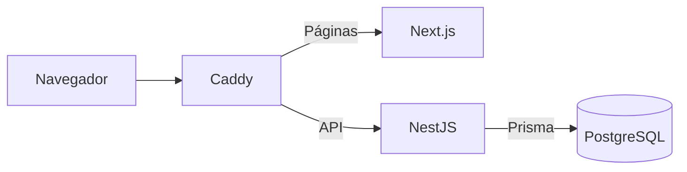

# Portal Bamak

<picture>
  <source media="(prefers-color-scheme: dark)" srcset="assets/brand/svg/bamak-lockup-horizontal-white.svg">
  
</picture>

**Portal institucional e comercial da Bamak Equipamentos LTDA.**

**Situação:** em desenvolvimento (PAC VIII).

[Documentação](docs/pac-viii/) · [Wiki](https://github.com/bredleyb/bamak-portal/wiki) · [Issues](https://github.com/bredleyb/bamak-portal/issues)

**Navegação rápida:** [Produto e escopo](#2-produto-e-escopo) · [Estado atual](#3-estado-atual-e-disponibilidade) · [Arquitetura](#4-tecnologias-e-arquitetura) · [Execução local](#6-execução-local) · [Testes](#7-testes-e-qualidade-de-código) · [Documentação](#11-documentação-e-organização-do-repositório) · [Roadmap](#12-roadmap-e-acompanhamento)

## 1. Visão geral

A Bamak Equipamentos LTDA atua no setor de equipamentos agrícolas. Seu site atual é estático e apresenta poucas informações sobre a empresa, seus produtos e as aplicações dos equipamentos.

O **Portal Bamak** tem como objetivo melhorar a presença digital da empresa e organizar o início dos atendimentos. Entre as funcionalidades previstas está um fluxo específico para solicitações do **Cabo Aéreo, produto patenteado pela empresa**, com registro de informações para análise inicial pela equipe. Orçamentos, negociações e demais etapas comerciais continuarão sendo conduzidos diretamente pela Bamak.

O projeto é desenvolvido individualmente no bacharelado em **Engenharia de Software da Católica de Santa Catarina**, em parceria com a Bamak. O planejamento começou no **PAC Extensionista VII**. Atualmente, o desenvolvimento técnico é realizado na disciplina de **Projeto de Portfólio**, com atividades de revisão, testes e validação junto à empresa no **PAC Extensionista VIII**.

## 2. Produto e escopo

### Áreas do portal

O Portal Bamak terá oito áreas públicas principais:

| Área | Finalidade |
|---|---|
| **Home** | Apresentação da empresa e acesso às principais áreas do portal. |
| **Institucional** | História, atuação e informações sobre a Bamak. |
| **Aplicações** | Contextos de utilização dos equipamentos e produtos. |
| **Catálogo** | Consulta de produtos, com busca, filtros e páginas de detalhes. |
| **Cabo Aéreo** | Informações sobre o produto e formulário específico de solicitação. |
| **FAQ** | Respostas às dúvidas mais frequentes. |
| **Comunicação** | Notícias, eventos, feiras, agenda e comunicados. |
| **Contato** | Canais de atendimento e formulário de contato geral. |

A área administrativa será restrita a usuários autorizados e contará com quatro módulos: **Painel**, **Atendimentos**, **Comunicação** e **Configurações**.

O sistema terá dois perfis de acesso. O **Administrador** poderá gerenciar usuários, conteúdos e configurações, além de acompanhar os atendimentos. O **Operador** terá acesso às funções necessárias para consultar e tratar solicitações, conforme suas permissões.

Na primeira versão, a edição de conteúdo pelo painel ficará concentrada na área de Comunicação. As demais páginas públicas terão manutenção técnica.

### Fluxos de negócio

O projeto contempla três fluxos principais, definidos conforme os requisitos da linha Web Apps:

1. **Contato geral (FL-01):** o visitante preenche o formulário, informa seu consentimento e envia a mensagem. A solicitação é registrada e disponibilizada no módulo de Atendimentos para acompanhamento pela equipe.

2. **Solicitação do Cabo Aéreo (FL-02):** o visitante informa seus dados de contato e os detalhes da necessidade, podendo acrescentar localização e imagens. A equipe consulta os dados em uma ficha interna. Usuários autorizados poderão gerar e armazenar um PDF reservado à equipe e enviá-lo ao e-mail institucional da Bamak.

3. **Publicação de conteúdos (FL-03):** o Administrador cria ou edita notícias, eventos e comunicados pelo painel, podendo salvar rascunhos, publicar e ocultar conteúdos. Somente as publicações autorizadas ficam disponíveis na área pública.

### Limites da primeira versão

O portal terá caráter institucional e consultivo. A primeira versão não incluirá compras online, pagamentos, orçamentos automáticos, cálculos técnicos de viabilidade do Cabo Aéreo ou um sistema completo de gestão comercial (CRM).

## 3. Estado atual e disponibilidade

**Estado verificado em 03/11/2026**, com base no commit [`03c052c`](https://github.com/bredleyb/bamak-portal/commit/03c052c79f62128b1dd31a09dbfd50fbab0bcb35):

| Área | Situação |
|---|---|
| **Interface pública** | Cabeçalho, navegação, rodapé e componentes compartilhados implementados. A Home ainda apresenta conteúdo técnico provisório. As páginas institucionais e de consulta estão pendentes na [Issue #94](https://github.com/bredleyb/bamak-portal/issues/94). |
| **Área administrativa** | Login, sessões, autorização por perfil e gestão de usuários integrados à `main` pela [Issue #96](https://github.com/bredleyb/bamak-portal/issues/96). O painel operacional e o gerenciamento de atendimentos estão pendentes na [Issue #97](https://github.com/bredleyb/bamak-portal/issues/97). |
| **Banco de dados** | Modelo de domínio e nove migrações Prisma versionadas. A aplicação das migrações pendentes em produção depende de publicação autorizada. |
| **Fluxos de negócio** | FL-01, FL-02 e FL-03 ainda não estão completos. As entregas são acompanhadas pelas Issues [#98](https://github.com/bredleyb/bamak-portal/issues/98), [#99](https://github.com/bredleyb/bamak-portal/issues/99), [#100](https://github.com/bredleyb/bamak-portal/issues/100) e [#101](https://github.com/bredleyb/bamak-portal/issues/101). |

### Ambientes disponíveis

O ambiente integrado pode ser iniciado localmente com Docker Compose, conforme as instruções da seção 6.

Existe também uma publicação técnica anterior, realizada para verificar a infraestrutura e o deploy automatizado. Essa versão é provisória e ainda não incorpora todas as funcionalidades integradas à `main`.

A atualização do ambiente publicado depende das verificações operacionais e da autorização de publicação. A validação da versão funcional com a Bamak e o aceite institucional permanecem pendentes.

## 4. Tecnologias e arquitetura

| Componente | Tecnologias | Responsabilidade |
|---|---|---|
| **Frontend** | Next.js, React, TypeScript e Tailwind CSS | Interfaces públicas e administrativas. |
| **Backend** | NestJS e TypeScript | API HTTP, autenticação, autorização e regras de negócio. |
| **Banco de dados** | PostgreSQL 17 e Prisma | Persistência de dados e migrações versionadas. |
| **Infraestrutura** | Docker Compose e Caddy | Execução dos serviços e proxy reverso. |
| **Automação** | GitHub Actions | Integração contínua e publicação controlada. |

### Visão arquitetural



O armazenamento privado de arquivos e o serviço de e-mail serão integrados nas próximas entregas funcionais.

## 5. Design e experiência

### Identidade e componentes

A interface utiliza o verde de referência `#00421F`, tons neutros e as fontes **Archivo**, nos títulos, e **Source Sans 3**, nos textos. Os ícones seguem a biblioteca Lucide.

O Design System reúne cores, tipografia, espaçamentos, padrões de interface e uma biblioteca de componentes com variantes de botões, campos, seleções, notificações, indicadores de estado e cartões.

### Protótipos, responsividade e acessibilidade

Os protótipos de alta fidelidade abrangem os três fluxos de negócio, com telas públicas e administrativas, estados alternativos e cenários de erro.

As especificações de interface contemplam larguras de **1440, 1024, 768 e 390 px**, além de diretrizes de contraste, foco visível, navegação por teclado e adaptação para telas menores.

As capturas demonstrativas da aplicação serão incorporadas após a implementação e verificação das respectivas interfaces, utilizando dados fictícios e identificação da versão apresentada.

## 6. Execução local

Os comandos abaixo são compatíveis com Windows PowerShell 5.1.

**Pré-requisitos para executar a aplicação:** Git e Docker Desktop com Docker Compose instalado e em execução.

### Preparação e inicialização

Clone o repositório e prepare as variáveis locais:

```powershell
git clone https://github.com/bredleyb/bamak-portal.git
Set-Location bamak-portal
Copy-Item .env.example .env
```

Inicie os serviços:

```powershell
docker compose --env-file .env -f compose.integrated.yaml up -d --build
```

A aplicação ficará disponível em:

- **Portal:** http://localhost:8080
- **Login administrativo:** http://localhost:8080/admin/login
- **Healthcheck da API:** http://localhost:8080/api/health

Verifique a conexão com a API e o banco de dados:

```powershell
Invoke-RestMethod http://localhost:8080/api/health
```

A resposta esperada contém `status: ok` e `database: ok`.

### Migrações do banco de dados

O Compose integrado não aplica as migrações Prisma automaticamente. Para preparar o esquema do PostgreSQL, utilize a imagem de migração definida no Dockerfile da API.

Com os serviços já iniciados, construa a imagem:

```powershell
docker build --target migration -t bamak-api-migration:local .\apps\api
```

Em seguida, carregue as configurações do arquivo `.env` e execute as migrações na rede local do Compose:

```powershell
$config = Get-Content .env -Raw | ConvertFrom-StringData
$dbUser = [Uri]::EscapeDataString($config['POSTGRES_USER'])
$dbPassword = [Uri]::EscapeDataString($config['POSTGRES_PASSWORD'])
$dbName = $config['POSTGRES_DB']

$env:DATABASE_URL = "postgresql://${dbUser}:${dbPassword}@db:5432/${dbName}?schema=public"

docker run --rm --network bamak-integrated_default --env DATABASE_URL bamak-api-migration:local

Remove-Item Env:DATABASE_URL
```

Confira a saída do Prisma para confirmar a aplicação das migrações.

### Explorar a implementação atual

A Home disponível no código atual apresenta uma tela provisória com o resultado da conexão entre Web, API e banco de dados.

A página `/admin/login` já possui uma interface de autenticação. O acesso às funções restritas exige uma conta administrativa válida.

**Limitação conhecida:** o ambiente não fornece credenciais administrativas padrão. A criação da primeira conta ainda requer um procedimento específico de inicialização, pendente de documentação e validação. A criação de usuários pela API já implementada pressupõe uma sessão de Administrador.

As páginas públicas definitivas e os três fluxos de negócio permanecem em desenvolvimento, conforme a seção 3.

### Consultar e encerrar o ambiente

Para verificar o estado dos serviços:

```powershell
docker compose --env-file .env -f compose.integrated.yaml ps
```

Para encerrá-los:

```powershell
docker compose --env-file .env -f compose.integrated.yaml down
```

O comando `down` preserva o volume do PostgreSQL. A remoção dos volumes apagaria os dados locais persistidos.

As credenciais do arquivo `.env.example` são destinadas exclusivamente ao desenvolvimento. O arquivo `.env` deve permanecer fora do controle de versão.

## 7. Testes e qualidade de código

O projeto utiliza testes automatizados de frontend, backend e integração com PostgreSQL. A linha Web Apps exige desenvolvimento orientado a testes (TDD), com cobertura mínima de **75% no backend** e **25% no frontend**.

A cobertura é acompanhada a cada incremento. A comprovação do processo de TDD depende dos ciclos de desenvolvimento registrados nos testes, commits e Pull Requests.

### Ferramentas e verificações

| Área | Ferramentas | Verificações |
|---|---|---|
| **API** | Jest, Supertest e PostgreSQL | Testes unitários, HTTP, integração, autorização e persistência. |
| **Web** | Vitest e Testing Library | Componentes, formulários, navegação e comportamentos de interface. |
| **Qualidade de código** | Oxlint na API e ESLint na Web | Verificações de código durante o desenvolvimento e na CI. |
| **Análise estática** | SonarCloud | Análise de qualidade e segurança, com Quality Gates para API e Web. |

### Executar os testes

Os comandos desta seção correspondem aos scripts versionados no repositório. Para executá-los fora dos contêineres, é necessário ter **Node.js 24 e npm** instalados.

**Web: lint e cobertura**

A partir da raiz do repositório:

```powershell
Set-Location .\apps\web
npm ci
npm run lint
npm run test:cov
Set-Location ..\..
```

**API: lint e cobertura**

A partir da raiz do repositório:

```powershell
Set-Location .\apps\api
Copy-Item .env.example .env
npm ci
npm run prisma:generate
npm run lint
npm run test:cov -- --runInBand --ci
Set-Location ..\..
```

Os testes que dependem de PostgreSQL exigem configuração apropriada do banco de dados e, em determinados cenários, bancos de teste isolados. A execução integral utilizada na CI também contempla migrações, verificações de integridade e suítes específicas de integração.

### Resultados da integração contínua

A [CI #41235377511](https://github.com/bredleyb/bamak-portal/actions/runs/41235377511), executada em 31/10/2026, registrou:

| Indicador | API | Web |
|---|---:|---:|
| Testes aprovados | 244 | 288 |
| Cobertura de linhas | 97,30% | 89,98% |
| Cobertura de ramificações | 83,51% | 86,66% |
| Quality Gate do SonarCloud | Aprovado | Aprovado |

**Total: 532 testes aprovados**, sem falhas. A etapa principal de testes da API registrou também 24 testes ignorados, com as suítes específicas de integração executadas separadamente.

Os resultados detalhados da análise estática e a triagem dos apontamentos residuais estão registrados na [Issue #102](https://github.com/bredleyb/bamak-portal/issues/102).

### Próximas verificações

Permanecem pendentes os testes ponta a ponta, as verificações de permissões e tratamento de falhas, além das avaliações de acessibilidade nos fluxos completos.

Essas atividades são acompanhadas pela [Issue #104](https://github.com/bredleyb/bamak-portal/issues/104). Os resultados históricos e os procedimentos de teste estão indicados na seção 11.

## 8. Segurança, privacidade e observabilidade

### Segurança administrativa

A autenticação administrativa utiliza senhas protegidas com hash, sessões com expiração e cookies `HttpOnly` e `SameSite=Strict`. Em produção, os cookies também exigem conexão segura.

A API verifica as permissões dos perfis **Administrador** e **Operador**. O sistema permite revogar sessões, desativar usuários e limitar tentativas de login. Alterações de acesso possuem registro de auditoria.

Esses mecanismos foram implementados e testados na [Issue #96](https://github.com/bredleyb/bamak-portal/issues/96).

### Proteção de dados

Os formulários de Contato e Cabo Aéreo deverão exigir consentimento explícito para o tratamento dos dados pessoais. O modelo de domínio já contempla o registro da data e da versão do consentimento.

As próximas entregas incluem armazenamento privado de imagens e PDFs, controle de acesso aos arquivos e validação dos limites de upload.

Credenciais, dados pessoais de clientes e documentos internos devem permanecer fora do repositório público. As políticas de retenção e os procedimentos de tratamento dos dados ainda precisam ser concluídos antes da operação com informações reais.

### Monitoramento e recuperação

A API possui um healthcheck que verifica sua conexão com o PostgreSQL. A infraestrutura também conta com uma rotina de backup do banco, cuja restauração foi testada em ambiente isolado.

A estratégia de recuperação será ampliada e revalidada antes da operação com dados reais.

A implementação de logs estruturados e monitoramento de falhas com **Sentry** está prevista na [Issue #103](https://github.com/bredleyb/bamak-portal/issues/103), incluindo cuidados para impedir a exposição de dados sensíveis na telemetria.

## 9. Integração contínua e publicação

### Integração contínua

O workflow [`ci.yml`](.github/workflows/ci.yml) é executado em Pull Requests e atualizações da branch `main`. Seus cinco jobs abrangem API, Web, scripts de deploy e análise estática dos dois projetos no SonarCloud.

### Publicação controlada

O workflow [`deploy.yml`](.github/workflows/deploy.yml) permite a publicação de commits da `main` após aprovação da CI e autorização explícita para a versão selecionada.

Quando existem novas migrações, o procedimento exige backup validado do PostgreSQL e aplicação controlada das alterações antes da atualização dos serviços.

A [Issue #87](https://github.com/bredleyb/bamak-portal/issues/87) registra a conclusão do primeiro deploy técnico automatizado em 19/10/2026, com [execução aprovada no GitHub Actions](https://github.com/bredleyb/bamak-portal/actions/runs/39183358655). A publicação da versão funcional estável, com verificações em produção e autorização institucional, permanece na [Issue #106](https://github.com/bredleyb/bamak-portal/issues/106).

## 10. Validação acadêmica e extensionista

O projeto segue os guias oficiais de [Portfólio](https://github.com/CatolicaSC-Portfolio/The-Portfolio-Playbook/blob/main/Portfolio.md), [PAC VIII](https://github.com/CatolicaSC-Portfolio/The-Portfolio-Playbook/blob/main/PAC%20Extensionista%20VIII.md) e [Web Apps](https://github.com/CatolicaSC-Portfolio/The-Portfolio-Playbook/blob/main/directions/portfolio-directions-webapp.md), que estabelecem os requisitos de desenvolvimento, comprovação de autoria, apresentação e validação.

### Revisões por pares e testes cruzados

O PAC VIII exige revisões de código por colegas em Pull Requests e testes funcionais cruzados, com registro dos problemas reproduzidos e das correções verificadas.

Essas atividades são acompanhadas pela [Issue #105](https://github.com/bredleyb/bamak-portal/issues/105) e permanecem pendentes de evidências de execução por colegas.

### Validação com a Bamak e devolutiva

O alinhamento inicial de escopo foi registrado com a Bamak. A versão funcional ainda precisa ser demonstrada e avaliada pela empresa.

A validação extensionista prevê apresentação dos fluxos implementados, registro de feedback, tratamento das alterações solicitadas e demonstração das melhorias. A entrega final também exige **termo de aceite ou declaração de encerramento assinada pelo parceiro**, além de evidência da devolutiva da solução.

A validação funcional é acompanhada pela [Issue #72](https://github.com/bredleyb/bamak-portal/issues/72), e a consolidação dos entregáveis pela [Issue #107](https://github.com/bredleyb/bamak-portal/issues/107).

## 11. Documentação e organização do repositório

### Estrutura principal

```text
bamak-portal/
├── .github/workflows/    # CI e publicação
├── apps/
│   ├── api/              # Backend NestJS e Prisma
│   └── web/              # Frontend Next.js
├── assets/brand/         # Identidade visual
├── docs/
│   ├── pac-vii/          # Histórico da concepção
│   └── pac-viii/         # Especificações e registros vigentes
├── final/pac-vii/        # Entregáveis acadêmicos do PAC VII
├── infra/                # Infraestrutura e automação operacional
├── compose*.yaml         # Configurações Docker Compose
└── README.md
```

### Documentos de referência

| Documento | Conteúdo |
|---|---|
| [RFC v2](docs/pac-viii/02-escopo/rfc-v2-pac-viii.md) | Escopo e decisões funcionais. |
| [Requisitos e fluxos](docs/pac-viii/03-requisitos/requisitos-user-stories-fluxos-metricas.md) | Histórias de usuário e critérios de aceite. |
| [Arquitetura Web Apps](docs/pac-viii/04-arquitetura/arquitetura-web-apps.md) | Componentes e integração do sistema. |
| [Modelo de domínio e contratos](docs/pac-viii/04-arquitetura/modelagem-dominio-contratos-api.md) | Entidades, persistência e API. |
| [Testes e cobertura](docs/pac-viii/04-arquitetura/testes-e-cobertura.md) | Estratégia e evidências de testes. |
| **Design e handoff** (`docs/pac-viii/05-design/`) | Diretrizes visuais e especificações de interface. |
| [Histórico e governança](docs/pac-viii/00-planejamento/historico-e-governanca.md) | Evolução e rastreabilidade das decisões. |

Os documentos de `docs/pac-vii/` e os entregáveis em `final/pac-vii/` preservam o histórico da concepção. As especificações vigentes estão organizadas em `docs/pac-viii/`.

## 12. Roadmap e acompanhamento

As próximas entregas estão distribuídas em quatro frentes:

| Frente | Entregas previstas |
|---|---|
| **Interfaces e operação** | Conclusão das páginas públicas, do Painel e do gerenciamento de Atendimentos. |
| **Fluxos de negócio** | Contato geral, solicitação do Cabo Aéreo, ficha e PDF internos e publicação de conteúdos. |
| **Qualidade e validação** | Observabilidade, testes integrados, acompanhamento de dependências, revisões acadêmicas e validação com a Bamak. |
| **Publicação e entrega** | Publicação estável e consolidação dos entregáveis técnicos e acadêmicos. |

As frentes podem avançar em paralelo conforme suas dependências. As prioridades, os critérios de aceite e os resultados são acompanhados nas [Issues do GitHub](https://github.com/bredleyb/bamak-portal/issues) e nos respectivos Pull Requests.

## 13. Suporte, manutenção e contribuições

### Registro de problemas e melhorias

Problemas reproduzíveis e sugestões técnicas podem ser registrados nas [Issues do GitHub](https://github.com/bredleyb/bamak-portal/issues), utilizando o [modelo de relatório de bug](.github/ISSUE_TEMPLATE/bug_report.yml).

Informações sensíveis não devem ser publicadas nas Issues. O procedimento privado para comunicação de vulnerabilidades e incidentes ainda precisa ser definido.

### Colaboração e manutenção

O desenvolvimento é individual. Propostas de alteração devem respeitar o escopo vigente e passar por Pull Request e verificações pertinentes.

As responsabilidades pela operação, atualização de conteúdo, suporte e manutenção após a entrega deverão ser definidas com a Bamak. Não há compromisso público de suporte continuado ou prazo de atendimento estabelecido.

## 14. Licenciamento e direitos de uso

O repositório é público para acompanhamento técnico e acadêmico e **não possui licença geral de código aberto**. A publicação no GitHub não concede autorização geral para reutilização, modificação ou redistribuição do código e da documentação, ressalvados os usos permitidos pela legislação e pelos termos da plataforma.

A identidade visual, os materiais institucionais e os conteúdos de terceiros estão sujeitos aos direitos e às autorizações de seus respectivos titulares. As dependências do projeto seguem suas próprias licenças.

A titularidade do software e as condições de utilização, operação, manutenção e eventual cessão de direitos dependem de definição entre as partes envolvidas.

**Desenvolvimento:** [Bredley Bauer](https://github.com/bredleyb), Engenharia de Software, Católica de Santa Catarina.